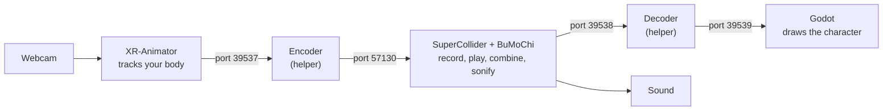

# 01 What BuMoChi Does

## The idea

BuMoChi lets you treat body movement as material for live coding. A camera watches you; your movement arrives in SuperCollider as numbers; from there you can pass it straight to an animated character, record it, replay it at another speed, give its arms to a different recording, or use it to play a synthesizer. Several people can share their movement over the network and each build their own version of the scene.

It uses only free software and an ordinary webcam.

## Four programs, two helpers



| Program | Its job | You interact with it by |
|---|---|---|
| **XR-Animator** | Finds your skeleton in the webcam image and sends it out | Switching its VMC output on |
| **Encoder** | Repackages each skeleton as one message for SuperCollider | Nothing: it runs in a terminal |
| **SuperCollider + BuMoChi** | The place where you work: everything you type goes here | Writing and running short lines of code |
| **Decoder** | Repackages BuMoChi's output for Godot | Nothing: it runs in a terminal |
| **Godot** | Shows the 3D character | Pressing Play on a project |

The encoder and decoder are two small Python scripts started together by a single command. You will rarely think about them again.

## Ports

Programs on one computer talk to each other through numbered **ports**, a little like extension numbers on one phone line. Each arrow in the diagram has a port number. You only ever type one of them yourself (`39537`, in XR-Animator). The rest are defaults. If the character does not move, the cause is almost always that one program is not running or one port number is wrong, which is why chapter 09 walks through them in order.

## Six words

| Word | Meaning |
|---|---|
| **Frame** | One snapshot of the whole skeleton: the position and rotation of 21 bones |
| **Bone** | One joint of the skeleton, such as `\Hips`, `\Head`, or `\LeftHand` |
| **Clip** | A recording: many frames with their timing. A clip never changes once recorded |
| **Avatar** | A character that receives movement, such as Ishidomaru |
| **Source** | Anything that supplies movement: the live camera, a clip, or code |
| **Sonification** | Turning movement values into sound |

The full vocabulary is in the [Glossary](../HelpByTopic/Glossary.md), but these six are enough for the workshop.

## The 21 bones

```text
Hips  Spine  Chest  Neck  Head
LeftShoulder   LeftUpperArm   LeftLowerArm   LeftHand
RightShoulder  RightUpperArm  RightLowerArm  RightHand
LeftUpperLeg   LeftLowerLeg   LeftFoot   LeftToes
RightUpperLeg  RightLowerLeg  RightFoot  RightToes
```

BuMoChi also knows these groups by name: `\leftArm`, `\rightArm`, `\arms`, `\leftLeg`, `\rightLeg`, `\legs`, `\torso`, `\upperBody`, `\all`.

Each bone carries seven numbers: a position (`x`, `y`, `z`) and a rotation written as a quaternion (`qx`, `qy`, `qz`, `qw`). You do not need to understand quaternions; in chapter 07 you will simply pick one of these numbers and listen to what it does.

Next: [02 Before the Workshop: Installation](02%20Before%20the%20Workshop%20-%20Installation.md)
